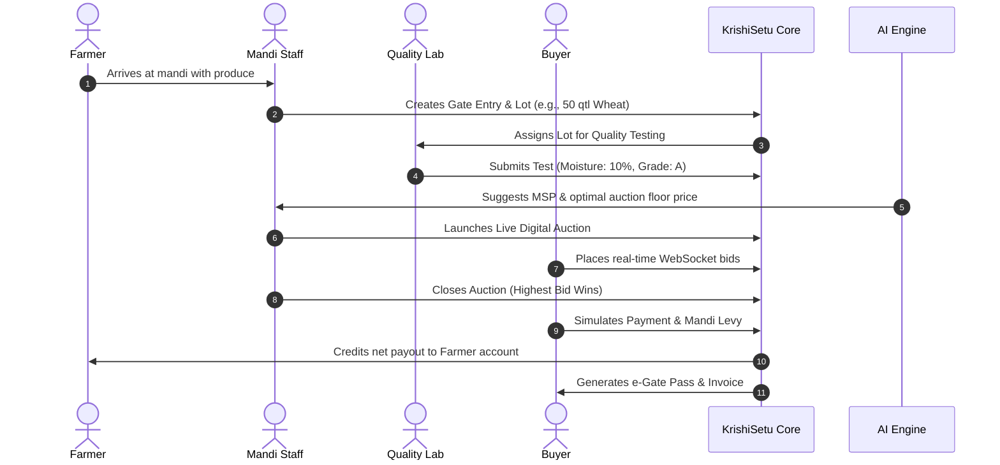

# 🌾 KrishiSetu — Digital National Agriculture Market Platform

> **"Connecting Farms. Creating Markets. Empowering Farmers."**

[](https://krishisetu-nine.vercel.app)
[](https://nodejs.org)
[](https://react.dev)
[](https://fastapi.tiangolo.com)
[](https://socket.io)
[](https://www.mongodb.com)

**KrishiSetu** is an end-to-end digital agricultural marketplace and smart auction platform inspired by India's e-NAM (*National Agriculture Market*). It bridges the gap between rural farmers, licensed agricultural mandis, certified quality testing labs, and institutional commodity buyers across India.

By pairing **real-time WebSocket digital auctions** with an **autonomous Python AI Market Intelligence Engine** (XGBoost, Random Forest, Holt-Winters smoothing, and Isolation Forests), KrishiSetu guarantees fair pricing, transparent quality grading, cross-mandi price discovery, and automated trade settlement.

---

## 🏛️ System Architecture

```mermaid
flowchart TD
    subgraph ClientLayer ["Client Layer (React 18 + Vite)"]
        UI["Web App (Vercel / Netlify)"]
        UI -->|SPA Routes| P1["Farmer Portal"]
        UI -->|SPA Routes| P2["Buyer Live Auction Room"]
        UI -->|SPA Routes| P3["Mandi Staff Gate Entry"]
        UI -->|SPA Routes| P4["Quality Assessor Lab"]
        UI -->|SPA Routes| P5["Admin & Market Intelligence"]
    end

    subgraph BackendLayer ["Application Core (Node.js & Express)"]
        API["REST API & Auth (Render)"]
        Socket["Socket.IO Real-Time Engine"]
        API -->|JWT + Role-Based Access| Auth["Auth Controller"]
        API -->|CRUD & Lifecycle| Lots["Lot & Auction Engine"]
        Socket -->|Sub-second Bids| Rooms["Live Auction Rooms"]
    end

    subgraph DataLayer ["Data & Storage Layer"]
        Mongo[("MongoDB Atlas Database")]
    end

    subgraph AILayer ["AI Intelligence Microservice (Python & FastAPI)"]
        FastAPI["AI Service (Render / Hugging Face Spaces)"]
        Predictor["Price Predictor (XGBoost / RandomForest)"]
        Forecaster["Time Series Forecaster (Holt-Winters)"]
        Anomaly["Anomaly Detector (Z-Score + Isolation Forest)"]
        MandiComp["Cross-Mandi Arbitrage Engine"]
        FastAPI --> Predictor
        FastAPI --> Forecaster
        FastAPI --> Anomaly
        FastAPI --> MandiComp
    end

    UI <-->|HTTP / REST| API
    UI <-->|WebSockets (Bid Stream)| Socket
    API <-->|Mongoose ODM| Mongo
    API <-->|Internal Microservice HTTP| FastAPI
```

---

## ✨ Key Features

### 1. 🧑‍🌾 Complete 5-Role Ecosystem
- **Farmer Portal:** Register produce batches, track warehouse lots, monitor live mandi bids, and verify instant direct bank settlements.
- **Buyer Room:** Browse cataloged lots with lab test certificates, join high-speed real-time bidding rooms, and generate auto-invoices.
- **Mandi Staff Hub:** Weighbridge intake, gate entry generation, lot status management, and auction initialization.
- **Quality Assessor Lab:** Grade moisture content, foreign matter, grain cleanliness, and issue tamper-proof digital certificates.
- **Admin Center:** Platform-wide oversight of commodities, volumes, trade settlements, audit trails, and user permissions.

### 2. ⚡ Real-Time Auction Engine (Socket.IO)
- **Sub-Second Bid Broadcasting:** Bid increments broadcast instantly across all connected participants with 0-refresh WebSockets.
- **Anti-Sniping & Server Validation:** Server-side validation guarantees bids cannot be placed below reserve price, below minimum increment, or after auction expiration.
- **Instant Settlement:** Automatic buyer invoice generation, payment simulation, and payout calculation with transparent mandi fee deductions.

### 3. 🤖 AI Market Intelligence Microservice
- **Ensemble Price Estimation:** Trains both `RandomForestRegressor` and `XGBoostRegressor` on engineered market features (lags, rolling averages, seasonality) and picks the winning model with confidence intervals.
- **Holt-Winters Trend Forecasting:** 7-day, 14-day, and 30-day forward price trajectories with upper/lower bounds.
- **Anomaly & Price Spike Detection:** Identifies artificial market manipulation or sudden supply gluts using Rolling Z-Score and Isolation Forest models.
- **Inter-Mandi Arbitrage Comparison:** Side-by-side price spreads and dispatch suggestions across major Indian mandis (*Azadpur, Vashi APMC, Koyambedu, Bowenpally, Gultekdi*).

---

## 🛠️ Tech Stack

| Domain | Technologies & Libraries |
|---|---|
| **Frontend** | React 18, Vite, React Router v6, Axios, Socket.IO Client, Pure CSS Modules |
| **Backend** | Node.js, Express.js, Socket.IO, Helmet, Morgan, Express-Rate-Limit |
| **Database** | MongoDB Atlas, Mongoose ODM |
| **AI / ML Service** | Python 3.11, FastAPI, Uvicorn, Scikit-Learn, XGBoost, Pandas, NumPy, Statsmodels |
| **Authentication** | JWT (JSON Web Tokens), Bcrypt.js password hashing, Role-Based Access Control |
| **Hosting & Cloud** | Vercel / Netlify (Frontend), Render (Node Backend & Python AI), MongoDB Atlas |

---

## 📂 Repository Structure

```
krishisetu/
├── frontend/                     # React + Vite Single Page Application
│   ├── public/                   # Static icons, manifest, _redirects for Netlify
│   ├── src/
│   │   ├── components/           # Navbar, AIMarketIntelligence, Layouts
│   │   ├── context/              # Auth & Socket Context providers
│   │   ├── pages/                # Role dashboards, Live Auctions, Marketplace
│   │   └── services/             # Axios API client & endpoints
│   ├── netlify.toml              # Netlify build configuration
│   └── vercel.json               # Vercel SPA rewrite rules
│
├── backend/                      # Node.js + Express + Socket.IO Server
│   ├── controllers/              # Auth, Lot, Auction, AI, Payment controllers
│   ├── middleware/               # Auth guards, role verification, error handlers
│   ├── models/                   # Mongoose schemas (User, Lot, Auction, Trade)
│   ├── routes/                   # Express route definitions
│   ├── services/                 # aiServiceClient, payment gateway simulation
│   ├── utils/                    # Seed scripts & demo data generator
│   └── server.js                 # HTTP + WebSocket server entrypoint
│
├── ai-service/                   # Python FastAPI Machine Learning Microservice
│   ├── app/
│   │   ├── data/                 # Adapters (Historical mandi prices & weather)
│   │   ├── models/               # XGBoost, RandomForest, Holt-Winters, Anomalies
│   │   ├── pipeline/             # Feature engineering & lag preprocessing
│   │   ├── services/             # Market comparison & recommendation engine
│   │   └── main.py               # FastAPI application endpoints
│   ├── saved_models/             # Serialized .joblib and meta .json models
│   ├── Dockerfile                # Production container for Hugging Face / Render
│   ├── train_all.py              # CLI batch training script
│   └── requirements.txt          # Python dependencies
│
└── README.md
```

---

## 🚀 Local Development Setup

### Prerequisites
- **Node.js**: v18.0.0 or higher
- **Python**: v3.10 or v3.11
- **MongoDB**: Local MongoDB instance (`mongodb://localhost:27017`) or free MongoDB Atlas URI

---

### Step 1: Backend Setup (Node.js & Express)

```bash
cd backend

# Install dependencies
npm install

# Setup environment file
cp .env.example .env
```

Configure your `backend/.env`:
```env
PORT=5001
MONGODB_URI=mongodb://127.0.0.1:27017/krishisetu
JWT_SECRET=super_secret_jwt_key_change_in_production
JWT_EXPIRES_IN=7d
CLIENT_URL=http://localhost:5173
AI_SERVICE_URL=http://localhost:8001
```

Seed initial commodities, demo accounts, active auctions, and lots:
```bash
npm run seed

# Start backend server with live reload
npm run dev
```
> Backend runs at `http://localhost:5001`.

---

### Step 2: AI Service Setup (Python & FastAPI)

Open a **second terminal**:

```bash
cd ai-service

# Create and activate Python virtual environment
python3 -m venv venv
source venv/bin/activate       # On Windows: venv\Scripts\activate

# Install machine learning packages
pip install -r requirements.txt

# Pre-train baseline models for all commodities & markets (takes ~3 seconds)
python train_all.py

# Start the FastAPI microservice
uvicorn app.main:app --port 8001 --reload
```
> AI Service runs at `http://localhost:8001` (Interactive Swagger docs: `http://localhost:8001/docs`).

---

### Step 3: Frontend Setup (React & Vite)

Open a **third terminal**:

```bash
cd frontend

# Install dependencies
npm install

# Setup environment file
cp .env.example .env
```

Configure your `frontend/.env`:
```env
VITE_API_URL=http://localhost:5001/api
VITE_SOCKET_URL=http://localhost:5001
```

Start the Vite development server:
```bash
npm run dev
```
> Open your browser at **`http://localhost:5173`**.

---

## 🔑 Demo Login Credentials

All seeded demo accounts use the standard password:
```
Demo@123
```

| Role | Email Address | Core Capabilities |
|---|---|---|
| **Admin** | `admin@krishisetu.demo` | System dashboard, audit logs, manage users |
| **Farmer** | `farmer1@krishisetu.demo` | Register produce, view active bids, settlement receipts |
| **Buyer** | `buyer1@krishisetu.demo` | Join live auction rooms, place bids, simulate payments |
| **Mandi Staff** | `mandi1@krishisetu.demo` | Gate entry, lot approvals, start/close digital auctions |
| **Quality Assessor** | `assessor1@krishisetu.demo` | Inspect produce, record moisture/damage, issue certificate |

*Additional test users `farmer2@krishisetu.demo` through `farmer10@krishisetu.demo` and `buyer2@krishisetu.demo` through `buyer10@krishisetu.demo` are also pre-seeded.*

---

## 🔄 End-to-End Workflow Walkthrough

Experience the full journey from harvest to payout:



1. **Gate Entry:** Log in as `mandi1@krishisetu.demo` ➔ Navigate to **Gate Entry** ➔ Enter farmer produce details.
2. **Quality Grading:** Log in as `assessor1@krishisetu.demo` ➔ Open **Quality Lab** ➔ Input moisture % and foreign matter ➔ Issue Certificate.
3. **Auction Activation:** Mandi staff approves the lot and creates an active auction room.
4. **Live Bidding:** Log in as `buyer1@krishisetu.demo` in one window and `buyer2@krishisetu.demo` in an incognito window ➔ Enter **Live Auctions** ➔ Place competing bids. Observe real-time bid updates across both screens without page refreshes.
5. **Settlement & Invoicing:** Close the auction ➔ As the winning buyer, click **Pay Now** ➔ Verify auto-generated tax invoice, gate pass, and farmer payout credit.

---

## 🌐 Production Deployment Architecture

KrishiSetu is designed with a modern decoupled cloud architecture:

```
┌─────────────────────────┐
│     Vercel / Netlify    │ ◄── React 18 SPA (Fast Global Edge CDN)
└───────────┬─────────────┘
            │ HTTPS / WSS
            ▼
┌─────────────────────────┐       ┌────────────────────────┐
│     Render (Node.js)    │ ◄───► │  MongoDB Atlas Cluster │
│  Express API + Socket   │       └────────────────────────┘
└───────────┬─────────────┘
            │ Internal REST
            ▼
┌─────────────────────────┐
│  Hugging Face / Render  │ ◄── Python FastAPI AI Microservice
│  FastAPI + Scikit/XGB   │     (2 vCPU / 16 GB RAM)
└─────────────────────────┘
```

### Environment Variable Reference

#### Frontend (`Vercel / Netlify`)
```env
VITE_API_URL=https://krishisetu-on9g.onrender.com/api
VITE_SOCKET_URL=https://krishisetu-on9g.onrender.com
```

#### Backend (`Render`)
```env
PORT=5001
MONGODB_URI=mongodb+srv://<user>:<password>@cluster0.mongodb.net/krishisetu
JWT_SECRET=your_production_jwt_secret
JWT_EXPIRES_IN=7d
CLIENT_URL=https://krishisetu-nine.vercel.app
AI_SERVICE_URL=https://krishisetu-ai-mbap.onrender.com
```

#### AI Microservice (`Render / Hugging Face Spaces`)
```env
PORT=7860
ALLOWED_ORIGINS=https://krishisetu-nine.vercel.app,https://krishisetu-on9g.onrender.com
```

---

## 🛡️ Security & Integrity Highlights

- **Server-Side Bid Authoritative Validation:** Clients cannot submit counterfeit bid amounts or tamper with timestamps; all bids are strictly verified against the MongoDB atomic log.
- **Role-Based Middlewares:** Secured routes use `protect` and `authorize('farmer', 'buyer', 'mandi_staff', 'admin')` decorators.
- **Defensive API Hardening:** Protected with `helmet` for secure HTTP headers, `cors` whitelisting, and `express-rate-limit` against DDoS/brute-force attacks.
- **Zero Plaintext Credentials:** Passwords stored using 10-round salted `bcrypt` hashes. Sensitive keys isolated in environment variables.

---

## ⚖️ License & Disclaimer

This project is open-source under the [MIT License](LICENSE).

*Disclaimer: KrishiSetu is an educational and prototype engineering platform inspired by agricultural digital transformation initiatives (such as India's e-NAM). All government IDs, payment gateways, and banking transactions simulated within this application are strictly synthetic demo data.*
